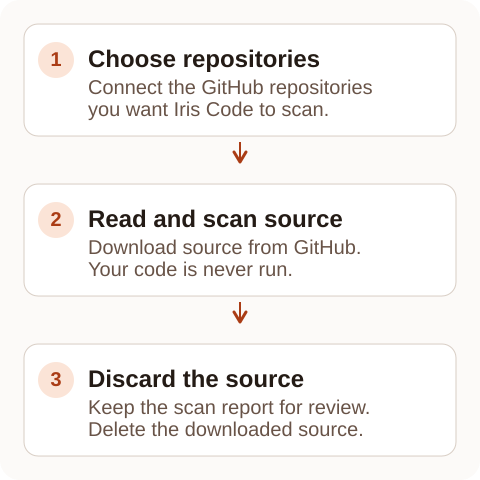
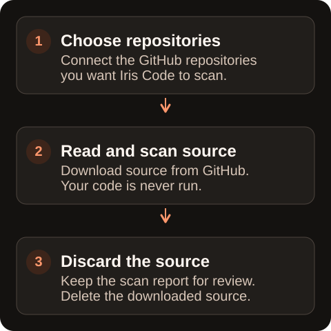

Local checks only run when someone has the code open. Cloud scans check a GitHub repository on Iris Code's servers instead, so a project's score stays up to date even when nobody is working on it.

You connect a repository, then scan it by hand or choose an event that scans it automatically, such as a change reaching the main branch. Each report records the exact version of the code it checked.

<Frame caption="The source is temporary; the scan report is retained.">
  
  
</Frame>

## What it checks

A cloud scan runs the same analysis as the editor and the CLI: the health score, findings by severity, which files were covered, and a report on the packages your project uses and their known vulnerabilities (CVEs). Nothing is scored differently because it ran in the cloud.

What differs is where the result is kept. Every scan, also called an audit, is stored against its commit, the identifier Git gives one saved version of your code. A report therefore describes one specific version, not "the code as it is now".

Each completed project report also has a [Code Map](/features/code-map) tab. It shows the repository's folder tree and the score of each file from that same commit.

<Note>
  This matters most for pull requests. A pull request scan records the latest commit on that branch, so reviewing a branch never overwrites your default branch's score. The two sit side by side, and each says which commit it describes.
</Note>

## What it does not do

Iris Code never runs your code. A cloud scan downloads a compressed copy of the source, unpacks it, reads the files, and reads the files that list your project's packages.

There is no clone, no `npm install`, no build step, and nothing from the repository is run at any point. Unpacking refuses symlinks and hardlinks (files that point to other locations), and the analysis step has no network access.

## How a repository gets connected

You install the Iris Code GitHub App on the repositories you choose. See [Connecting GitHub](/cloud/connect-github) for the permissions it asks for and why.

Importing a repository starts one scan straight away, so the project has a score before you have configured anything. That first scan counts against your allowance like any other.

## What triggers an audit afterwards

New repositories start in manual mode: after the import scan, nothing is scanned until you ask. You can choose to scan automatically when a change lands on your default branch, when a pull request is updated, or both.

These automatic scans use the same monthly cloud allowance as manual ones, including on Free. The two options use very different numbers of scans, and the setting says so. See [Audit triggers](/cloud/triggers).

## Reports and retention

Every scan keeps its full report for **400 days**. After that, the detailed report is removed but a summary line is kept: what ran, on which commit, and with what outcome. An old link then shows that the detail is no longer kept, rather than a broken page.

In your account, **Audit history** lists those summary lines across every connected repository. It shows the repository, commit, branch, what started the scan, its status, score and time, without opening each project separately.

**Analytics** is a separate screen for recorded activity, such as workspace scans, gates, blocked pushes and a row for each completed cloud scan, shown beside your health trend.

Disconnecting a repository permanently deletes its cloud reports from that account or team. A record of the deletion is kept and nothing on GitHub is changed. To scan it again, you would need to connect it again.

## Personal and team repositories are separate

A personal account and a team each have their own connected repositories, their own reports and their own scan allowance. They are never shared or combined.

Holding a seat in a team does not let that team's allowance scan your own repositories, and your personal subscription does not scan theirs. See [Scan allowances](/cloud/allowances).

## What you need

- A signed-in Iris Code account. Free personal accounts and Free Teams have a monthly cloud allowance; Pro, and teams with an active subscription or trial, have their own allocation. See [Free allowances](/free)
- A GitHub account with permission to install an App on the repository you want audited

<Tip>
  To keep a project's score current at the lowest cost, scan merges to your default branch and leave pull request scans off. See [Audit triggers](/cloud/triggers).
</Tip>
