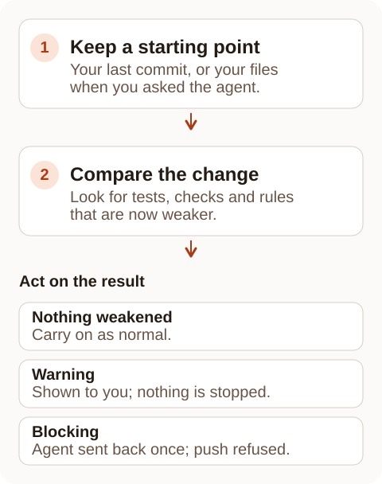
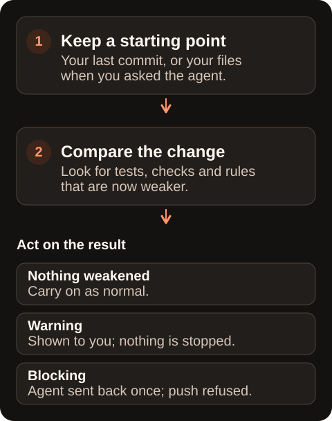

Tests and project rules only protect your code while they stay switched on. A coding agent asked to make failing tests pass can skip a test, delete it or lower a threshold instead of fixing the code, and the run then looks green.

Verification integrity compares a change with how your files were before it and reports anything that makes your checks weaker. It is Free on every plan.

<Frame caption="Only weakening that the change introduced is reported. A test that was already skipped before the change is not a new finding.">
  
  
</Frame>

## What it catches

Each kind of weakening has its own rule. Some block by default, because they remove a check outright. Others warn, because a person needs to judge whether the change was reasonable.

| Rule | What it means | Example | Default |
| --- | --- | --- | --- |
| `test-removed` | A test was deleted | The test "refunds a cancelled order" no longer exists | Blocks |
| `test-disabled` | A test was switched off, or focused so its neighbours stop running | A test is marked `it.skip` | Blocks |
| `rules-loosened` | A project threshold became more lenient | `minHealthScore` lowered from 75 to 50 | Blocks |
| `assertions-weakened` | A test now checks fewer things | A test with three `expect` calls now has one | Warns |
| `checker-silenced` | A comment now tells a checker to ignore a line | A new `// @ts-ignore` or `# noqa` | Warns |
| `type-widened` | A precise type was replaced with one that accepts anything | `as any` in TypeScript | Warns |
| `error-swallowed` | An error is now caught and ignored | An empty `catch {}` | Warns |
| `iris-suppressed` | A new `iris-ignore` comment hides an Iris Code finding | `// iris-ignore: console-log -- debug` | Warns |
| `code-packed` | Several statements were squeezed onto one line, a way to get under a length limit | Four statements on one line | Warns |

A threshold is a configured limit, such as the minimum health score. Lowering one in the same change cannot hide itself: the comparison always reads your settings from the starting point, not from the change.

## Where it runs

The same comparison runs in each place you work. The starting point it compares against, called the baseline, depends on where it runs.

| Where | What it compares | How to turn it on |
| --- | --- | --- |
| When a coding agent finishes | Your files when you sent the agent your request | `iris hook agent install --verify-on-finish` |
| **Review My Changes** in VS Code or JetBrains | Your last commit | Run **Iris Code: Review My Changes** |
| The terminal | Your last commit | `iris check . --integrity` |
| Before a push | What the remote branch already has | The [Git hook](/enforcement/git-hook) (installing it needs Pro) |
| A coding agent over MCP | Your last commit | `iris_check` with `changed: true`, through [MCP](/agents/mcp) |

The agent finish check works with Claude Code, Codex, Cursor, GitHub Copilot and Gemini CLI. Windsurf does not give tools a way to act when the agent finishes, so it is not supported there.

## Acting on the results

**When a coding agent finishes.** A blocking finding sends the agent back once. It is told what weakened and asked to restore the check or stop and explain the change to you. If it finishes again without fixing it, it is not sent back a second time; you see the findings instead.

The agent is also told not to add a suppression itself. Deciding that a weakening is intended is your call, not the agent's.

**In Review My Changes.** Findings appear in a **Verification integrity** section above the health score, each with its file and line. A deleted test shows the line it was on, since the file may no longer exist.

**At a push.** A blocking finding refuses the push and lists what weakened. Warnings are printed and the push goes ahead. Reinstall the Git hook after updating to 1.40.0 or later so a passing push also shows its warnings.

To fix a finding, restore the test, assertion or setting that was weakened. If the change was deliberate, record why, as described next.

## Confirming a deliberate change

Sometimes weakening a check is the right decision, for example when a flaky test is replaced by a better one. Record the reason so the finding is accepted, while staying visible to anyone reviewing the change.

In the editor, click **This is intended** on the finding and type a reason. This covers your local review only. It lapses if you edit the change, and it does not let a push or CI run through.

For pushes and CI, add an `Iris-Allow` line to the commit message. It names the rule, the file and the reason:

```text
Iris-Allow: test-removed tests/old.test.ts -- replaced by integration coverage
Iris-Allow: code-packed src/generated-view.ts -- reviewed compact layout
Iris-Allow: test-disabled tests/orders.test.ts#orders > refunds -- service maintenance
```

The part after `#` limits an allowance to one named test. `code-packed` always applies to a whole file, so it takes no `#` part. A line without a reason, or naming an unknown rule, is reported as invalid and allows nothing.

Allowed findings stay in the report with their reason. An `iris-ignore` comment with a reason can also allow a single line, but the new comment is itself reported as `iris-suppressed`.

## Running it

In a terminal:

```bash
iris check . --integrity
iris check . --integrity --staged
iris check . --integrity --from main --format json
```

The first compares your working files with your last commit. `--staged` checks exactly what you have prepared for the next commit with `git add`. `--from` compares against another branch or commit instead.

The command exits with `1` when a finding blocks, `0` when nothing blocks and `2` when a flag is wrong. `--format json` adds an `integrity` report with each finding, the number that block and anything that could not be checked.

## Packed code

`code-packed` reports when a change joins statements onto shared lines. Squeezing code this way can bring a long file or function under its length limit without making it any simpler. File and function length already count joined statements as extra lines; this rule reports the packing itself.

It warns when a file gains at least three joined statements. Only new packing counts: moving existing packed code or editing a word on a packed line does not. Strings, comments, loop headers and short inline markup are not counted.

To change the threshold, set `codePackedThreshold` in `.irisconfig.json` to a whole number of 1 or more. The default is `3` for every preset and language. Raising it in the same change is reported as `rules-loosened`.

```json
{
  "codePackedThreshold": 5,
  "severityOverrides": { "code-packed": "error" }
}
```

Packing warns at a push and in CI. Set `severityOverrides["code-packed"]` to `"error"` to make it block, or to `"info"` to make it quieter. It cannot be turned off; list generated files in `ignoreFiles` instead.

When a coding agent finishes, packing sends it back once to split the lines or explain, even though it is only a warning. That uses the same single correction as the other findings.

## Baselines and limits

**One correction per turn.** An agent is sent back at most once per request. Verification integrity and [refactor verification](/refactor/verification) share that single correction, however many problems they find.

**When the starting point is missing.** If the files from the start of the agent's turn are unavailable, the check compares against your last commit and says so in its message.

**Size limits.** Uncommitted files saved at the start of an agent's turn are kept outside your repository, in `~/.iris/turns`, up to 5 MiB. Each file read for a comparison is capped at 1 MiB, and one comparison at 50 MiB. Anything left out is listed as not checked, never treated as clean.

**Pushes.** The pre-push step checks each branch you push against what the remote branch already has. A new branch is compared with the point where it left its upstream branch. `Iris-Allow` lines are read from every commit in the push.

## What is not checked

Test readers recognise named tests in TypeScript, JavaScript, Vue, Svelte, Go, Python, Ruby, C#, Java and Rust. A test whose name is built at runtime, or whose boundaries cannot be found, is listed as not checked.

Counting assertions shows that a test checks fewer things. It cannot show that a replacement assertion is as strong as the one it replaced, so review rewritten tests yourself.

Some rules cover fewer languages:

- `type-widened` has nothing to check in JavaScript or Ruby, which have no type annotations. Java `Object` parameters are left out because they are too common to be useful, and Rust has no equivalent catch-all type.
- `error-swallowed` cannot see every ignored error in Go and Rust, because recognising a call that returns an error needs type information. It checks the common patterns.

Iris Code never runs your repository's code to read a setting. Coverage thresholds that are computed, lint settings written as code or YAML, files it cannot parse and configuration inherited from outside the repository are listed as not checked.

## Related pages

- [Review My Changes](/features/change-review)
- [Using refactor plans with an agent](/refactor/agents)
- [Git hook](/enforcement/git-hook)
- [Inline suppressions](/enforcement/suppressions)
- [.irisconfig.json reference](/configuration/irisconfig)
- [MCP server](/agents/mcp)
