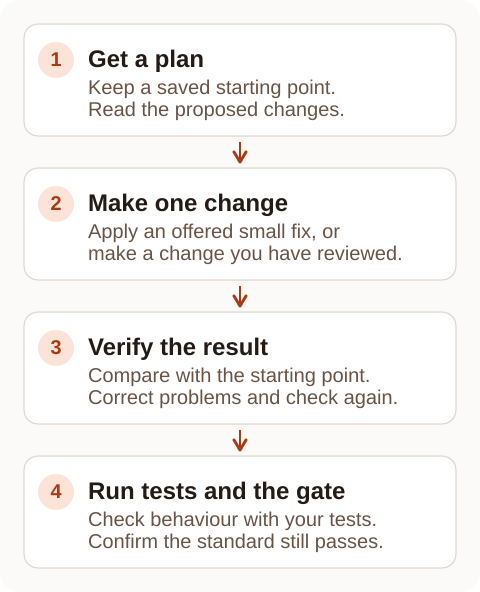
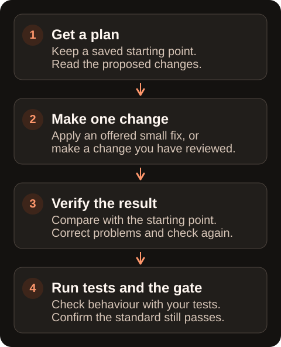

Refactoring means reorganising code so it is easier to understand and maintain, without changing what the program does. It is easy to get wrong: a file can look shorter while doing the same work, or a moved function can break the files that use it.

The Refactor Playbook gives you a plan for the change, offers small fixes it can apply for you, and then checks your edits against a saved copy of the code from before you started. Planning and checking a single file is Free.

## Acting on the results

Open **Refactor plan** from the File, Folder or Workspace tab in VS Code or a JetBrains IDE. Opening the panel does not read your code; **Get plan** starts the scan.

File plans and verification are Free. A new folder or workspace plan can use one action from the selected personal or team allowance. Once you have that plan, it keeps its saved starting point, and applying its approved fixes and verifying it do not use another project action.

<Frame caption="Make one change at a time, then check it before continuing.">
  
  
</Frame>

**Get plan** reads the files you selected and the surrounding code it needs to understand them. It includes changes you have not saved yet, and looks at how your project already lays out its files.

It also keeps a copy of the code in the editor's memory. This saved starting point is called the **baseline**: verification compares your later edits with it. Getting a new plan replaces it.

A plan has four parts:

| Part | Purpose | Output |
|---|---|---|
| Mechanical fixes | Small edits Iris Code can check before offering them | Changes you can preview and apply |
| Conventions | Follow the way your project already organises files | Suggested locations for moved code |
| Suggestions | Explain larger changes for you or an agent to review | What to move, where to move it and what could be affected |
| Verification | Check whether an edit helped or introduced a problem | A verdict, reasons and suggested corrections |

**Apply mechanical fixes** applies the offered small fixes as one change. **Undo** restores that change if you want to reconsider it.

Larger structural suggestions, such as moving functions into another file, need review. You or your coding agent make those edits; Iris Code does not apply them automatically.

Use **Open agent instructions** to read the plan, or **Copy full plan** to share its instructions and JSON with your coding agent. JSON is a structured version of the same plan that software can read.

After editing, choose **Verify refactor**. If it finds a problem, **Copy correction for your agent** gives the agent the details to work on.

## Free and Pro

| Surface | Free | Pro |
|---|---|---|
| File plan and verification | Yes | Yes |
| Top-level refactor settings | Yes | Yes |
| Language overrides | Applied when signed in; ignored with a warning otherwise | Applied |
| Folder and workspace plans in the editor | Within monthly project allowance | Included local access |
| MCP folder and workspace plans | Within monthly project allowance | Included local access |

MCP is the connection that lets a coding agent call Iris Code tools; see [Agent integration](/refactor/agents).

Iris Code does not call an AI model to create or check a plan. Verification can find problems, but it cannot prove that your program still behaves exactly the same. Review the changes, run your tests and run the gate before treating the work as complete.

A verification verdict does not change whether a push or build passes its gate. The Playground does not include the Refactor Playbook.

## Related pages

- [Fixes and suggestions](/refactor/reference)
- [Conventions](/refactor/conventions)
- [Verification](/refactor/verification)
- [Configuration](/refactor/configuration)
- [Agent integration](/refactor/agents)
- [Language coverage](/refactor/language-coverage)
