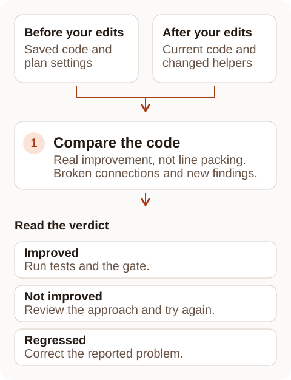
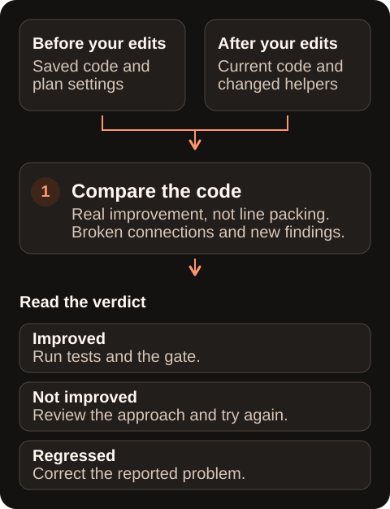

After a refactor, you want to know two things: did the code actually get better, and did anything break? A file can look shorter because statements were squeezed onto fewer lines, and a moved function can leave another file importing something that no longer exists.

Verification answers both questions. It compares your edited code with a saved copy from before you started, called the baseline, and gives one of three verdicts. Putting the same code on fewer lines does not count as an improvement.

## Acting on the results

| Verdict | Worked example | Next action |
|---|---|---|
| `improved` | Move ten constant declarations from a twenty-code-line file into a resolving helper; a failing metric decreases without new findings | Run tests and the configured gate; continue only if the gate still fails |
| `not-improved` | Join twenty declaration lines into one while keeping the same tokens, or remove only comments and blanks | Restore useful formatting and make a structural change |
| `regressed` | A moved file imports a missing module, or an export is removed while a consumer still imports it | Restore the reported regression, then verify again |

When verification finds a problem, it also gives a correction: the problems to fix and any checks that could not run. You can pass it to your coding agent.

## Verification checks

<Frame caption="Verification compares the saved starting point with the code after your edits.">
  
  
</Frame>

A helper is a new file or function that takes over some of the original work. Verification checks changed helpers as well as the original file. Imports and exports are the connections that let those files use each other's code.

In short, verification looks for a real improvement in the measure that was failing, and for new problems: imports that no longer work, import loops, removed exports that other files still use, files it cannot read, and new findings. Each check has an ID, listed below.

### Checks reference

| Check | Evidence | Setting |
|---|---|---|
| V1 | A failing file/function code-line metric, function/import count, complexity or health score improves | Always reported |
| V2 | Packing: token-drop proportion divided by code-line-drop proportion is below the configured ratio | `verify.packing` |
| V3 | Only comments or whitespace changed | `verify.commentOnly` |
| V4 | A relative import fails to resolve, including imports in new helpers | `verify.importsResolve` |
| V5 | A new import cycle appears | `verify.importCycles` |
| V6 | An imported export is removed; consumers are checked against both snapshots | `verify.removedExports` |
| V7 | A public export is removed without an observed importer; review the API change | `verify.removedExports` |
| V8 | A changed file cannot be analysed, or new findings appear | Parse refusal is always reported; findings use `verify.newFindings` |
| V9 | Before/after health score, code lines and tokens for every touched file | Always reported |

The comparison covers added, changed and deleted source files, even a new helper the caller did not mention. Each helper is checked with the settings that apply to it.

Findings are compared one by one, including their severity. Keeping the same total number of findings does not hide a finding that has changed.

## Packing detection

A shorter file is not necessarily simpler. Joining several statements onto one line hides the length without reducing the work the code does. Iris Code calls this **packing**.

Tokens are the pieces of code, such as names and operators. Comparing how much the line count and token count fall helps tell removed work apart from squeezed formatting.

For example, if code lines fall from 100 to 50 but tokens only fall from 1,000 to 950, the ratio is `0.05 / 0.50 = 0.10`. The default threshold is `0.6`, so that reduction is put down mainly to packing. The verdict reports how many lines it attributes to packing and the ratio used.

Verification counts code lines without comments. Ordinary file-length findings still count total lines, as before.

The exact result of an offered mechanical fix is exempt from the packing penalty. Iris Code checks, against the saved starting point, that the whole file matches either one offered fix or the complete batch. Extra edits or line packing do not qualify.

The exemption does not skip the other checks. Broken imports, removed exports, code that cannot be analysed and new findings are still reported.

## Baselines

The baseline is the copy of the code that verification compares with. Where it comes from depends on where you got the plan.

The editor and the MCP server (the connection a coding agent uses to call Iris Code tools) can keep the plan's copy in memory. A separate CLI command cannot: once that command ends, its copy is gone. The CLI therefore normally compares your edits with your last commit, called **Git HEAD**.

| Baseline | Lifetime and disclosure |
|---|---|
| `baseline_id` from an MCP plan or failing `iris_check` | Source snapshot held only in the live server session; no before-source file is accepted |
| Editor plan | Includes unsaved editor buffers and persists for that editor host session |
| Git HEAD fallback | The baseline is the last commit; the comparison includes your existing uncommitted changes. |

In plain terms: an MCP plan's copy lasts only while that server runs, and an agent cannot supply its own "before" file. An editor plan includes your unsaved changes and lasts until the editor closes.

An unknown baseline ID is refused rather than quietly replaced with your last commit. Every verdict reports `disabledChecks` and `packingRatioUsed`, so you can see when switched-off checks left less to go on.

### Settings are saved with the plan

The saved starting point also keeps the plan's `refactor` settings, including `maxCorrections` and the verification switches. Changing those settings afterwards cannot make the same plan easier to pass.

The result shows `policyChangedSincePlan: true` when those settings change. Get a new plan to use the new settings. Permission for an agent to use Iris Code is still checked on every call.

Your analysis settings decide which problems Iris Code reports. Loosening a threshold or turning off a detector could hide a problem the edit introduced.

So if an applicable `.irisconfig.json` is changed, added or removed after an editor or MCP plan, verification reports `regressed` and `configChangedSincePlan: true`. Restore the config or get a new plan before verifying again.

A comparison against your last commit works differently: it treats a config edit as part of your uncommitted work.

### Restricted folders

Over MCP, a changed file in a folder where the agent handoff is off is left out of the results and the correction. The result shows only how many were withheld, as `withheldByPolicy`, and the verdict still counts them.

## Limits

Verification gives advice; it cannot prove that the program still behaves exactly the same. Run your tests as well.

A `regressed` verdict does not make the CLI command exit with an error code. Read the verdict rather than treating a successful command as a successful refactor.

Invalid arguments and baseline errors still fail the command. Corrections name the problems to address and any checks that could not run.

## Related pages

- [Overview](/refactor/overview)
- [Fixes and suggestions](/refactor/reference)
- [Conventions](/refactor/conventions)
- [Configuration](/refactor/configuration)
- [Agent integration](/refactor/agents)
- [Language coverage](/refactor/language-coverage)
